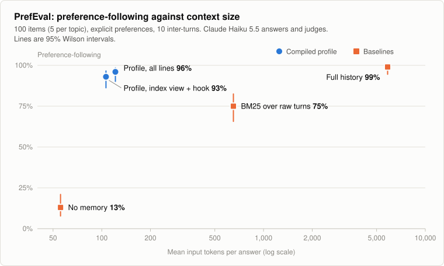
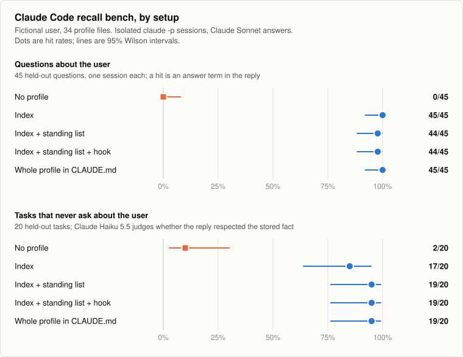

# Unified Memory

Claude keeps what it knows about you in several places: account memory on claude.ai, auto memory and
`CLAUDE.md` files in Claude Code, skills, scheduled-task prompts. They drift apart, and you end up repeating
yourself. Unified Memory keeps one profile of you as Markdown files in a local git repository, laid out like
Claude's account memory. It is compiled from what you say in Claude Code sessions: a model proposes changes,
each with a quote from the evidence, and code decides which ones land. Tool output can never override
something you said. Claude Code reads the profile through a generated index. An optional bridge mirrors it into
claude.ai account memory, so chat and mobile see the same facts.

This is a Claude Code plugin and the benchmark code behind it. It is a personal research project by AJ Wallace,
not an Anthropic product. The numbers are small-sample; read [the limits](#limits) before quoting any of them.

## Results

| Benchmark | n | Result |
| --- | --- | --- |
| **PrefEval** (public; explicit preferences, 10 inter-turns) | 100 items | Compiled profile: 96% preference-following [90 to 98] at 121 mean input tokens. BM25 over the raw turns: 75% [66 to 82] at 651 tokens. Full history: 99% [95 to 100] at 5,850 tokens. No memory: 13% [8 to 21]. |
| **Claude Code recall bench**, questions about the user (ours; fictional user) | 45 held-out questions | No profile 0/45. Generated index 45/45. Whole profile pasted into `CLAUDE.md` 45/45. Index plus standing list 44/45. Index plus standing list and prompt hook 44/45. |
| **Claude Code recall bench**, tasks that never ask about the user | 20 held-out tasks, judged by Claude Haiku 5.5 | No profile 2/20. Index 17/20. Whole profile 19/20. Index plus standing list 19/20. Index plus standing list and prompt hook 19/20. |
| **Replay** (ours; synthetic users, false claims planted in tool output) | 490 probes per arm, seed 1 | Combined error: doing nothing 90/490, compile with code checks 0/490. Planted claims accepted: 66/90 against 0/90. A second seed gave 12/490 and 7/490 against 91/490 and 90/490. |

Brackets are 95% Wilson intervals. What the table does and does not show:

- On PrefEval the compiled profile beat BM25 retrieval over the raw conversation by 21 points [+12 to +30]
  and used about a fifth of its input tokens. It did **not** beat full history. The difference is -3 points
  [-7 to +1], which is a tie at this sample size, at about 2% of the input tokens. The token counts are for
  the answer call only; compiling the profile is a separate model call.
- On the recall bench the index ties the whole-profile baseline on direct questions (45/45 each) and is two
  tasks behind it on implicit tasks (17/20 against 19/20, intervals overlap). The prompt hook and the
  standing list did not measurably improve on the index (hook minus index on implicit tasks: +10 points
  [-10 to +30]), so both ship turned off.
- The recall bench numbers are from a rerun. The first runs let a session read files outside its folder.
  Those rows were withdrawn and are not published. Each setup was then run once, with Claude Sonnet, with
  sessions confined to their folders.
- The replay result is from templated synthetic users. It shows the checks and the write-time hook doing
  what they were built to do, not how the system behaves on real histories.





All numbers, their source files and what was not run are in [docs/RESULTS.md](docs/RESULTS.md).

## Install

You need Claude Code, `git`, and `python3` (3.10 or later) on your `PATH`. The project was developed and run on
macOS. Linux is untested. Windows is not supported: the hooks use Unix file locking.

```sh
claude plugin marketplace add ajwallacemusic/unified-memory
claude plugin install unified-memory@unified-memory
```

Then, in a Claude Code session:

```
/unified-memory:setup
```

Setup asks where the profile should live (it suggests `~/claude-profile`; the folder must not be under
`~/.claude`), creates it as a git repository, and offers to add one import line to `~/.claude/CLAUDE.md`. That
line is what lets every Claude Code session read the profile. Setup asks before it changes the file.

Model calls go through `claude -p` on your own Claude plan by default. No API key is needed.

## Quickstart

| Command | What it does |
| --- | --- |
| `/unified-memory:compile` | Reads your Claude Code sessions since the last compile and adds what you said about yourself. Writes a receipt and one git commit. |
| `/unified-memory:status` | Last build, held items, pending questions, anything that needs you. |
| `/unified-memory:answer <text>` | Answers a pending question. The answer is kept as something you said. |
| `/unified-memory:undo` | Reverts the last compile. |
| `/unified-memory:erase <value>` | Removes a value from the profile, its records and its evidence, and lists raw copies left in other apps. Asks first. |
| `/unified-memory:bridge` | Walks you through connecting the profile to claude.ai account memory. Optional. |

A typical first day: run setup, work as usual, then run `/unified-memory:compile` and read the receipt it shows
you. The profile is plain Markdown under git, so you can read it and see every change in `git log`.

## How it works

```
Claude Code sessions ──> evidence ──> compile ──> checks ──> profile (git) ──> index ──> Claude Code
(origin from structure)              (a model)    (code)          │
                                                                  └──> bridge ──> claude.ai account memory
                                                                      (optional)   (chat, mobile, tasks)
```

1. **Evidence.** The compile reads Claude Code transcripts. Each piece gets an origin from the transcript's
   structure, never from a model: something you typed, something the assistant wrote, or tool output.
2. **Compile.** A model proposes changes to the profile. Every change must cite evidence and quote it.
3. **Checks.** Code accepts or refuses each change. The quote must exist in the cited evidence and mention
   what the change asserts. Tool output can add a line but can never replace or remove one. A line you stated
   changes only on something you said. A blocked change becomes a question, at most three a week.
4. **Profile.** Accepted changes are committed to the profile's git repository with a receipt.
5. **Readers.** Claude Code imports a generated index: the core profile lines, and one line per other file
   (its path and a description) so the session can open the file a question needs. The bridge copies the
   same files into claude.ai account memory.

A second hook, the memory guard, covers the write side: in a turn that has taken in web, shell or MCP tool
output, a direct write to the profile or to Claude Code's memory files is denied, and the text is held as
tool-output evidence for the next compile.

Two options are off by default, because neither showed a measured gain on the recall bench. The prompt hook
adds matching profile lines to each prompt. The standing list puts lines labelled as standing preferences
inline in the index. Turn them on with `"prompt_hook": true` and `"standing": true` in
`~/.config/unified-memory/config.json`.

More detail: [docs/DESIGN.md](docs/DESIGN.md).

## Privacy and safety properties

- **Tool output cannot override what you said.** This is enforced in code, in the checks and in the memory
  guard hook, not left to the model. In the replay benchmark the hook was necessary: without it, 90 of 90
  planted claims got through when the memory writer recorded tool output.
- **Receipts and undo.** Every compile writes a receipt (what changed, the quote, its source) and exactly one
  commit. `/unified-memory:undo` reverts it.
- **Erase.** Removes a value from the profile, lineage, answers and evidence. It can also rewrite the
  profile's git history if you ask. It reports raw copies that remain in other apps' files; it does not delete
  those.
- **Local by default.** The profile and its evidence stay in a folder on your machine. The plugin has no
  server of its own. Model calls go to Claude through your own `claude` login, the same place your sessions
  already go. The profile reaches claude.ai account memory only through the bridge, and only if you set it up.
- **The bridge starts in propose-only mode.** It writes nothing to account memory until two reviewed runs in
  a row have nothing rejected. Local code decides what may be pushed, under a category policy and a block on
  card, ID and credential patterns. Versions are checked so an edit made in a chat is not overwritten.

## Limits

- **Small samples.** 100 PrefEval items, 45 questions, 20 implicit tasks, two replay seeds of five users. Each
  recall bench setup was run once, with one answering model.
- **It is not a memory of past conversations.** The profile keeps current facts and preferences about a person. On LongMemEval-S (100 questions about past sessions), the earlier clean-up arms scored 82% against 91% for full context and 85% for searching the raw files; in a 10-question pilot the compiled profile scored 2/10 against 9/10 for BM25. For questions about past events, retrieval over history wins. See [RESULTS](docs/RESULTS.md) section 4.
- **A fictional user and model-written labels.** Claude models wrote the recall bench's user, questions,
  implicit tasks and checks, and the hook's expansion words, standing labels and background prompts. No
  person checked them.
- **Judges are Claude Haiku 5.5.** PrefEval was not scored with the paper's judge model. No judge from another
  model family was run. No human evaluation was done.
- **One model family built, ran and scored the benchmarks.**
- **PrefEval is not run in the paper's format.** Every condition gets its context in the system prompt, which
  likely helps the full-history baseline. Only the 10 inter-turn setting was run; 300 was not. Each PrefEval
  item has one preference, so each compiled profile is one line.
- **The bridge depends on a claude.ai scheduled task.** It needs the Claude desktop app open on the machine
  that holds the profile, and it relies on behaviour observed on one account in November 2026, not on
  documented guarantees.
- **The compile's mention check sometimes rejects valid changes.** The check requires a change's quote to
  mention what the change asserts, by a word-matching rule. A rejected change is not applied, so a fact you
  stated can fail to reach the profile. How often this happens has not been measured.
- **Real use is barely measured.** A canary test of recall across surfaces on a real account exists and is
  not published, because it involves personal data.

## Documents

- [docs/RESULTS.md](docs/RESULTS.md): every number, with n, intervals, source file and caveats.
- [docs/DESIGN.md](docs/DESIGN.md): the design, what was tried and dropped, what is not built.
- [docs/BENCHMARKS.md](docs/BENCHMARKS.md): the commands that produce each number.

License: MIT (see [LICENSE](LICENSE)).
