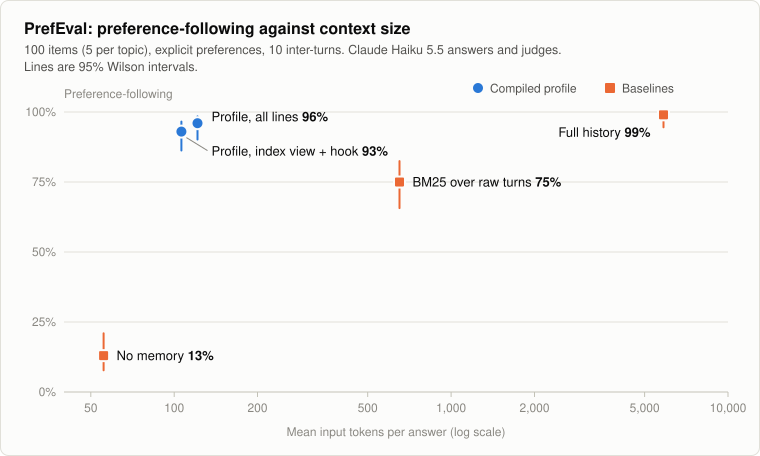
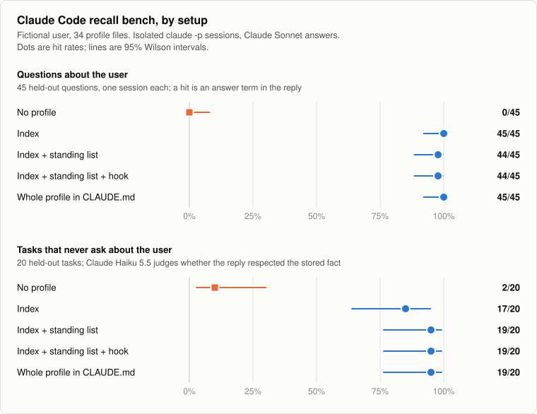

# Results

Everything measured for Unified Memory between November 10 and 20, 2026, with the file each number comes from.
[BENCHMARKS.md](BENCHMARKS.md) has the commands. Paths are relative to the repository root.

Conventions:

- Intervals in square brackets are 95% Wilson intervals on a proportion.
- Differences are in percentage points, paired on the same items, with a 95% bootstrap interval. An interval
  that contains zero is reported as a tie.
- "Sonnet" and "Haiku" mean Claude Sonnet 5.5 and Claude Haiku 5.5 unless a section says otherwise.
- Every benchmark here was built, run and scored with Claude models. Section 8 says who wrote which labels.
  Section 9 lists what was not run.

## Summary

| # | Benchmark | n | Compared | Result |
| --- | --- | --- | --- | --- |
| 1 | PrefEval, explicit preferences (public) | 100 items, at 10 and at 300 inter-turns | compiled profile, BM25 over raw turns, full history, no memory | At 10: profile 96%; BM25 75%; full history 99%; none 13%. Profile beats BM25 (+21 [+12, +30]) and ties full history (-3 [-7, +1]). At 300: profile 84%; BM25 36%; full history 81%; none 17%. Profile beats BM25 (+48 [+36, +60]) and ties full history (+3 [-7, +13]). |
| 2 | Claude Code recall bench (ours, fictional user) | 45 questions, 20 implicit tasks, each with two answering models | no profile, index, index + standing list, index + standing list + hook, whole profile | Sonnet: index 45/45 and 17/20; whole profile 45/45 and 19/20; standing list 44/45 and 19/20; hook 44/45 and 19/20; no profile 0/45 and 2/20. Haiku: index 44/45 and 15/20; whole profile 45/45 and 17/20; standing list 41/45 and 16/20; hook 42/45 and 17/20; no profile 0/45 and 1/20. The standing list and the hook add nothing measurable with either model. |
| 3 | Replay (ours, synthetic) | 490 probes per arm and run | do nothing (Z), two clean-up passes (A0, A), checked compile (B) | Combined error Z 90/490, A0 122/490, A 101/490, B 0/490 on seed 1. B beats Z on a second seed too. |
| 4 | LongMemEval-S (public) | 100 questions | Z, A0, A, full context, raw files with search | Z 82%, A 82%, A0 76%, full context 91%, files 85%. B was not part of this run; row 6 has it. |
| 5 | MemoryAgentBench FactConsolidation (public) | 10 questions (pilot) | same as 1 | Out of scope. The profile stored nothing. |
| 6 | Conversation search: LongMemEval-S and PrefEval (public) | 100 questions, 100 items | profile, search, profile + search, full context | LongMemEval-S: profile 42%, search 74%, profile + search 74%, full context 91%. Search beats the profile alone (+32 [+22, +42]) and trails full context (-17 [-27, -8]). Four runs of profile + search scored 74, 77, 77 and 75 (mean 75.75). PrefEval: 93% with the search tools offered against 94% without (-1 [-6, +4]); the tools were never called. A third tool, `read_chat`, was tested over four runs per arm and not shipped (6.8). |

## 1. PrefEval

PrefEval (Zhao et al., ICLR 2025) tests whether an assistant follows a preference the user stated earlier in
a conversation. We used the explicit-preference subset and the generation task. The dataset is CC BY-NC 4.0.
This repository holds results only; the data and the judge prompts are read at run time from a local clone
and are not redistributed.

Source: `results/public-bench/2026-11-19-prefeval-100/results.jsonl` (500 rows: 100 items by 5 conditions) and
`run_meta.json` beside it. `python3 scripts/make_charts.py` prints the table below from that file.

**Set-up.** 100 items, 5 from each of the 20 topics, drawn with a fixed seed. The history is the stated
preference, the assistant's reply to it, and 10 unrelated exchanges ("inter-turns"). Haiku answered and ran
PrefEval's four judge checks. For the two profile conditions, Sonnet first compiled the history into a profile
with the same compile and checks the plugin uses, starting from an empty profile.

| Condition | What the answer model is given | Following the preference | 95% interval | Mean input tokens | Answers cut off |
| --- | --- | --- | --- | --- | --- |
| No memory | nothing | 13/100 | 8 to 21 | 56 | 9 |
| BM25 over raw turns | best-matching lines of the raw conversation, up to 4,000 characters | 75/100 | 66 to 82 | 651 | 29 |
| Compiled profile, all lines | every line of the compiled profile | 96/100 | 90 to 98 | 121 | 43 |
| Compiled profile, index view + hook | what a Claude Code session has before it opens a file: core lines, standing lines, and lines the prompt hook matches | 93/100 | 86 to 97 | 106 | 47 |
| Full history | the whole conversation | 99/100 | 95 to 100 | 5,850 | 59 |

Paired differences:

| Comparison | Difference | 95% interval | Reading |
| --- | --- | --- | --- |
| Profile, all lines, minus BM25 | +21 | +12 to +30 | profile better |
| Profile, index view + hook, minus BM25 | +18 | +8 to +28 | profile better |
| Profile, all lines, minus full history | -3 | -7 to +1 | tie |
| Profile, index view + hook, minus full history | -6 | -12 to -1 | profile worse |
| Profile, index view + hook, minus profile, all lines | -3 | -7 to 0 | tie |

**What this shows.** A one-line compiled profile carries a stated preference about as well as the whole
conversation does, in about 2% of the answer's input tokens, and better than word-matching retrieval over the
raw turns.

**What it does not show, and what differs from the paper.**

- **Context placement.** Every condition gets its context inside the system prompt. PrefEval presents the
  history as earlier chat turns. A transcript in the system prompt is probably easier to use, which likely
  inflates the full-history score.
- **10 inter-turns.** The history is about 5,800 tokens, so full history is an easy baseline here. Section
  1.1 repeats the test at PrefEval's 300 inter-turn setting.
- **Judge.** Haiku 5.5 ran the four checks, not the judge model used in the paper. These numbers are not
  comparable with published PrefEval scores.
- **Output limit.** Answers could use 1,000 output tokens (PrefEval: 300), because Haiku 5.5 spends part of
  its output budget before it writes and answers at 300 were cut off in a pilot. Many answers still hit the
  limit (last column). A cut-off answer was judged as it stood. Three answers were empty at the limit, one
  under BM25 and two under the index view + hook condition; they count as failures and were not judged.
- **Four compiles stored nothing.** For 4 of 100 items the compile proposed no change, so both profile
  conditions answered with no context. These are all four failures of the all-lines condition.
- **The index view + hook number is not evidence for the hook's retrieval.** In this run every stored
  preference was labelled a standing line (96 of 96), so it was in context whether or not the hook matched.
  Recomputed offline from the run's profiles, the hook's word match fired for 23 of the 96. The three items
  where this condition trails the all-lines condition are the two empty answers and one cut-off answer.
- **The index view + hook condition is not the plugin's default.** It has the standing list and the prompt
  hook switched on. The plugin ships with both off (section 2.5).
- **The condition was changed after a pilot.** In a 20-item pilot
  (`results/public-bench/2026-11-19-pilot/summary.json`) the condition was core lines plus hook matches, with
  no standing lines and no expansion words. It put nothing in context and scored 6/20. It was then changed
  to the index view described above. One of the pilot's 20 items is also in the 100-item sample.
- **The change cap was lifted.** The compile ran with its per-pass cap on changes effectively off. No compile
  in this run proposed more than one change, so the plugin's default cap would have held nothing back.
- **Token counts are for the answer call.** They exclude the compile, which is one Sonnet call per history
  (about 7,700 input tokens each in this run), and the judge calls.
- **One preference per item.** Each profile is one line. This says nothing about recall from a large profile;
  section 2 covers that.

The per-profile figures in this list (the four empty profiles, the standing labels, the hook matches and the
compile sizes) come from the run's working files, which sit beside benchmark text and are not published.
Answers and judging cost $0.65 through the API (the sum of the `usd` and `judge_usd` fields in the results
file). Compiles ran on a Claude subscription.

### 1.1 At 300 inter-turns

Source: `results/public-bench/2026-11-19-prefeval-100-t300/results.jsonl` (400 rows: 100 items by 4 conditions)
and `run_meta.json` beside it. [BENCHMARKS.md](BENCHMARKS.md) section 2 has a command that prints the two
tables below from that file.

**Set-up.** The same 100 items and the same models. The history now has 300 unrelated exchanges after the
stated preference, not 10, which makes it about 162,000 tokens. Two other things differ from the run above:
answers could use 4,000 output tokens, not 1,000, and the index view + hook condition was not run.

| Condition | Following the preference | 95% interval | Mean input tokens | At 10 inter-turns |
| --- | --- | --- | --- | --- |
| No memory | 17/100 | 11 to 26 | 56 | 13/100 |
| BM25 over raw turns, up to 4,000 characters | 36/100 | 27 to 46 | 1,433 | 75/100 |
| Compiled profile, all lines | 84/100 | 76 to 90 | 161 | 96/100 |
| Full history | 81/100 | 72 to 87 | 162,462 | 99/100 |

| Comparison | Difference | 95% interval | Reading |
| --- | --- | --- | --- |
| Profile minus full history | +3 | -7 to +13 | tie |
| Profile minus BM25 | +48 | +36 to +60 | profile better |
| Full history minus BM25 | +45 | +34 to +56 | full history better |

**What this shows.** Every condition with memory scored lower with the longer history. Paired on the same
items across the two runs, BM25 fell 39 points [-49 to -29], full history 18 [-26 to -11] and the compiled
profile 12 [-20 to -4]. At 300 inter-turns the profile ties the full history while the answer call reads
about a thousandth of the input tokens (161 against 162,462), and it is 48 points ahead of BM25, whose
4,000-character budget did not grow with the history.

**What it does not show.**

- **The profile did not beat full history.** +3 points with an interval from -7 to +13 is a tie: 15 items were
  right only with the profile and 12 only with the full history.
- **Every profile failure is a compile that stored nothing.** For 17 of the 100 items the compile proposed no
  change (4 of 100 at 10 inter-turns), so the answer had no context. 16 of those 17 answers did not follow
  the preference. All 83 answers given a profile with at least one line did. The loss at 300 inter-turns is
  the compile missing the preference in a long history, not the answer model ignoring a stored line.
- **The compile reads the whole history once.** It is one Sonnet call per item of about 162,500 input tokens,
  on a Claude subscription, and is not in the token column. The profile saves tokens on each answer after
  that, not on the first.
- **The two runs are not a controlled pair.** They differ in the output limit as well as the history. No
  answer was cut off at 4,000 output tokens; at 1,000, between 9 and 59 per condition were. The no-memory
  condition gets the same input in both runs and moved from 13 to 17 (+4 [0 to +9]), which shows how much
  a score moves for reasons other than the history.
- **One run, in three invocations.** The three baselines ran first. The profile condition was stopped by the
  plan-usage limit after 29 items and finished some hours later with the same command.
- **Profiles are one to three lines** (17 of one line, 64 of two, 2 of three). All 151 proposed changes were
  applied, with the change cap lifted as above; the plugin's default cap of 5 would have held none back.
- The limits on context placement and the judge listed above apply here too. Implicit preferences, the
  classification task and the paper's multi-turn format were not run at either length.

The compile figures in this list come from the run's working files, which are not published. Answers and
judging cost $8.75 through the API (the sum of the `usd` and `judge_usd` fields), of which $8.39 is the
full-history condition.

## 2. Claude Code recall bench

Our own benchmark. It asks whether Claude Code knows facts about its user when those facts sit in a stored
profile. Data and scoring rules: [`bench/recall/README.md`](../bench/recall/README.md).

**The data.** A fictional user, Wren Halvorsen, with a profile of 34 files and 271 fact lines in the layout
of Claude's account memory. 90 questions (27 direct, 45 paraphrased, 18 that need two files), 40 off-topic
prompts and 40 implicit tasks, each split in half into dev and test. Retriever choices were tuned on dev.
Every number below is from the held-out test half.

**The sessions.** Each question runs in its own non-interactive Claude Code session (`claude -p`) in a scratch
folder, isolated from the runner's own settings, memory, plugins and MCP servers
(`um/bench/cc_run.py`). Only the Read, Glob and Grep tools exist. A session can read its own folder and, in
the three index setups, the profile folder. The bench was run once with Claude Sonnet answering and once with
Claude Haiku (the `sonnet` and `haiku` aliases of Claude Code; the exact model ids are not recorded). The
setups:

| Setup | What the session has |
| --- | --- |
| No profile | nothing |
| Index | `CLAUDE.md` holds the generated index: the core profile lines, then one line (path and description) per other profile file. The session may read those files. This is what the plugin ships. |
| Index + standing list | the index, plus the lines labelled as standing preferences listed inline (123 of the 263 labelled lines) |
| Index + standing list + hook | the standing setup, plus the prompt hook, which adds matching profile lines to the prompt |
| Whole profile | every profile file pasted into `CLAUDE.md` (the full-context baseline) |

Input tokens are what `claude -p` reports for the whole session, including Claude Code's own system prompt
and every turn. A session that opens a file has more turns, so it counts more tokens.

**These numbers are from a rerun.** The first runs of this bench, earlier on November 19, passed
`--allowedTools Read,Glob,Grep` to each session. That let a session read any file on the machine, not only
its own folder. Every row from those runs was withdrawn and none is published. The flag was removed, a read of
the parent folder was checked by hand and was denied, and the Sonnet runs below were repeated with the current
code. The Haiku runs were made later the same day with the same fixed code. Each setup was run once per
model.

### 2.1 Questions about the user

Sources: `results/recall-bench/2026-11-19-e2e-summary.json` (Sonnet; rows in `2026-11-19-e2e.jsonl`) and
`2026-11-19-e2e-haiku-summary.json` (Haiku; rows in `2026-11-19-e2e-haiku.jsonl`). 45 questions: 13 direct,
23 paraphrased, 9 two-file. A hit is an answer term appearing in the reply.

| Setup | Sonnet: hits | 95% interval | Mean input tokens | Haiku: hits | 95% interval | Mean input tokens |
| --- | --- | --- | --- | --- | --- | --- |
| No profile | 0/45 | 0 to 8 | 8.0k | 0/45 | 0 to 8 | 6.8k |
| Index | 45/45 | 92 to 100 | 17.2k | 44/45 | 88 to 100 | 19.1k |
| Index + standing list | 44/45 | 88 to 100 | 23.7k | 41/45 | 79 to 96 | 25.5k |
| Index + standing list + hook | 44/45 | 88 to 100 | 17.8k | 42/45 | 82 to 98 | 19.5k |
| Whole profile | 45/45 | 92 to 100 | 16.2k | 45/45 | 92 to 100 | 17.0k |

**Sonnet.** The index ties the whole-profile baseline at the ceiling. Index minus hook is +2 points [0 to +7],
a tie. Standing list minus hook is 0. The standing and hook setups each missed one question, the same two-file
question. In both, the reply named the right person from the first file and said the fact held in the
second file was unknown. Every other cell is full marks, so 8 of 9 two-file questions for those two setups
and 9 of 9 for the index and the whole profile.

**Haiku.** The order is the same and every difference is still a tie: index minus hook +4 points [0 to +11],
standing list minus hook -2 [-9 to +4], whole profile minus hook +7 [0 to +16]. The index missed one
question, the two-file question that the Sonnet standing and hook setups missed. The hook setup missed that
one, a second two-file question and one paraphrased question. The standing setup missed two two-file and two
paraphrased questions. All direct questions were hits in every profile setup.

The hook setup used fewer input tokens than the standing setup (17.8k against 23.7k), although it holds
everything the standing setup holds. Tokens are counted over every turn, so this fits hook sessions opening
fewer files. The rows do not record which files a session opened, so this is not confirmed.

On the 20 off-topic test prompts (`2026-11-19-e2e-offtopic.jsonl` and `2026-11-19-e2e-haiku-offtopic.jsonl`,
index and hook setups only) the hook setup used 27.9k mean input tokens against 17.4k for the index with
Sonnet, and 43.3k against 24.5k with Haiku. The hook setup includes the standing list, and the standing setup
was not run on off-topic prompts, so the extra cannot be split between the two.

One edit was made to the published rows. In three Haiku off-topic answers under the hook setup, the session
quoted its own hook setting, which named the repository's folder on the machine that ran the bench. That path
is replaced by `<repo>` in those three rows. The runner has since been changed so a session's settings no
longer name it; the published hook rows of both models were made before that change.

### 2.2 Tasks that never ask about the user

Sources: `results/recall-bench/2026-11-19-implicit-summary.json` (Sonnet; rows in `2026-11-19-implicit.jsonl`)
and `2026-11-19-implicit-haiku-summary.json` (Haiku; rows in `2026-11-19-implicit-haiku.jsonl`). 20 tasks (10
work, 10 life), such as drafting, planning or writing code, where one stored fact should change the answer and
the prompt does not mention it. Haiku 5.5 (`claude-haiku-5-5`) judged each reply YES or NO against a check
question, so in the Haiku run the same model answered and judged. Claude wrote the tasks and the check
questions when it wrote the bench. No person reviewed the checks or the verdicts.

| Setup | Sonnet: passed | 95% interval | Mean input tokens | Haiku: passed | 95% interval | Mean input tokens |
| --- | --- | --- | --- | --- | --- | --- |
| No profile | 2/20 | 3 to 30 | 7.0k | 1/20 | 1 to 24 | 12.0k |
| Index | 17/20 | 64 to 95 | 18.0k | 15/20 | 53 to 89 | 26.8k |
| Index + standing list | 19/20 | 76 to 99 | 25.7k | 16/20 | 58 to 92 | 33.0k |
| Index + standing list + hook | 19/20 | 76 to 99 | 25.1k | 17/20 | 64 to 95 | 26.0k |
| Whole profile | 19/20 | 76 to 99 | 19.8k | 17/20 | 64 to 95 | 24.3k |

**Sonnet.** The index is two tasks behind the other three profile setups, and the intervals overlap. Hook
minus index is +10 points [-10 to +30], a tie. Hook minus standing list and hook minus whole profile are both
0 [-15 to +15]. The three setups at 19/20 each failed a different task. Two tasks passed with no profile, so
some checks can pass by chance. Twenty tasks cannot tell a two-task gap from noise.

**Haiku.** The same picture, two or three tasks lower in each profile setup. The index is two tasks behind the hook and the
whole profile: hook minus index is +10 points [-10 to +30], a tie. Hook minus standing list is +5 [-10 to
+20] and hook minus whole profile is 0 [-15 to +15]. One task failed under all four profile setups and
another under three of them. One task passed with no profile.

The chart draws the Sonnet runs only.

### 2.3 Variants that were withdrawn

Before the isolation fix, the bench was also run with Claude Haiku answering, with five questions per
session, and with sessions placed inside a fictional project. Those runs had the same fault as the first
runs above: a session could read outside its folder. Their rows were withdrawn with the rest. The Haiku run
was repeated after the fix and is reported in 2.1 and 2.2. The other two were not rerun, so this document
reports no result for them. The published results cover two models, one question per session, and a scratch
folder with no project in it.

### 2.4 The hook's retriever, offline

Source: `results/recall-bench/2026-11-19-retrieval.json`. No model is involved. Recall is the share of
questions for which the text the hook would inject contains an answer term. Off-topic injection is the share
of off-topic prompts that get any profile line. "Before" is plain word overlap; "after" adds expansion words
written per profile line at compile time and a discount for words common in generic developer prompts.

| Held-out test half | Before | After |
| --- | --- | --- |
| Recall, all 45 questions | 36% (16/45) | 56% (25/45) |
| Direct (13) | 85% | 85% |
| Paraphrased (23) | 0% | 43% |
| Two-file (9) | 56% | 44% |
| Off-topic prompts given a line (20) | 35% | 15% |

The change helps paraphrased questions and cuts off-topic injection. It does not help two-file questions, and
15% off-topic injection is above the 5% the project had set as its target for this step.

### 2.5 Conclusion

With the generated index, Claude Code finds profile facts on its own. The index is a list of the profile's
files with a description of each, imported by `CLAUDE.md`. On questions it matches the whole-profile baseline
with Sonnet (45/45 each) and is one behind with Haiku (44/45 against 45/45). On implicit tasks it is two
behind with both models (17/20 against 19/20, and 15/20 against 17/20), which n=20 cannot separate from noise.

On this bench the prompt hook and the standing list did not earn their place. Neither moved a score outside
its interval with either model. On questions both scored at or below the index: with Sonnet each missed one
two-file question that the index answered, and with Haiku they scored 42 and 41 against the index's 44. The
standing list cost tokens: 23.7k against 17.2k mean input tokens per question session with Sonnet, 25.5k
against 19.1k with Haiku. The one sign in their favour is on implicit tasks, two extra with Sonnet and one or
two with Haiku, and those differences have intervals that include zero.

The plugin therefore ships with both off. The index is the mechanism. Each option can be switched on in
`~/.config/unified-memory/config.json`: `"prompt_hook": true` and `"standing": true`. That ruling was made on
the Sonnet runs. The Haiku runs came after it and do not change it.

The offline gain in 2.4 did not carry over. The retriever change raised held-out recall from 36% to 56%
offline, but end to end a Claude Code session with the index already opens the right file.

The hook's retrieval may be useful where a model cannot open files. This project has no clean measurement of
that case: the PrefEval condition that includes the hook was carried by standing lines (section 1).

## 3. Replay benchmark

Our own synthetic benchmark for the compile's checks. Five templated users over six weeks each. Facts change
over time, and false claims are planted in tool output. After each week the arm rewrites the stores and probe
questions are answered from the result. Each run scores 490 probes per arm: 275 for stale facts served, 125
for valid facts wrongly retired ("false stale"), 90 for planted claims accepted.

The arms:

- **Z:** do nothing. The stores as the memory writer left them.
- **A0:** Anthropic's shipped `consolidate-memory` skill, run automatically on each memory store.
- **A:** our own pass that reads every store in one context and writes a new version.
- **B:** the checked compile this plugin ships, with the write-time hook that keeps tool output away from the
  memory writer.

Sonnet ran each arm's pass. Haiku wrote the stores and answered the probes. Labels are the generator's own
truth, scored by a fixed string rule. B's questions were answered by an oracle, a simulated person. Two
writers were tested: "plain" records only what the person said; "absorb" also records what tools report.

**Seed 1.** Sources: `results/synth/2026-11-10-plain/report.md` and `results/synth/2026-11-10-absorb/report.md`.

| Arm | Combined error, plain writer | Minus Z | Combined error, absorb writer | Minus Z | Planted claims accepted, plain / absorb |
| --- | --- | --- | --- | --- | --- |
| Z | 90/490 | | 90/490 | | 66/90, 90/90 |
| A0 | 122/490 | +7 (+3 to +10) | 91/490 | +0 (+0 to +1) | 73/90, 90/90 |
| A | 101/490 | +2 (-1 to +6) | 90/490 | +0 (+0 to +0) | 67/90, 90/90 |
| B | 0/490 | -18 (-22 to -15) | 0/490 | -18 (-22 to -15) | 0/90, 0/90 |

Only B beat doing nothing. A0 was worse than Z with the plain writer and tied it with absorb. A tied Z in
both. Neither clean-up pass lowered planted-claim acceptance. False stale could not be decided between the
arms: Z, A and B all scored 0 of 125, so the benchmark has no headroom there.

**Stress test.** Source: `results/synth/stress/report.md`. The rules were written before the runs and
evaluated by code.

- **Second seed.** B minus Z on combined error: -16 points (-20 to -12) with the plain writer, -17 (-20 to
  -14) with absorb. B was not at zero: 12 of 490 and 7 of 490.
- **The hook is necessary.** With the absorb writer, B without the write-time hook accepted 90 of 90 planted
  claims on both seeds, the same as Z. The checks cannot refuse a claim the writer has already recorded.
- **Unanswered questions.** B still beat Z when its questions were never answered (-6 points), answered a
  week late (-15) or answered half the time (-13), seed 1. That hides a trade: with no answers B served
  stale facts on 59 and 60 of 275 probes, against Z's 24 and 0, because it holds every change it cannot
  confirm.
- **Erase.** 0 of 30 erased probes leaked in answers and 0 files held an erased value, for each of A, B and
  Z. The replay has no bridge, so this shows only that the erase function removes text from the current
  files.
- **A hole, and a fix that has not fired.** On seed 2 with the absorb writer, B accepted 6 of 90 planted
  claims. The compile had added a contradicting line cited to tool output, and the override rule did not
  look at adds. The checks now treat an add that restates a labelled line as an override. In a rerun of four
  runs (`results/synth/addfix/report.md`) B minus Z was -24, -18, -19 and -19 points with 0 of 90 planted
  claims accepted in each, but the new rule did not fire in that rerun. It is shown only by unit tests and an
  offline replay of the original proposal.

**Limits of the replay.**

- The users are templated, so absolute scores flatter every arm. Compare arms, not levels.
- One model family built the generator, the writer, the arms, the oracle and the spot-checks.
- Two seeds of five users. The oracle modes and the erase test ran on seed 1 only.
- The scorer is a strict string rule: a hedged answer counts as accepting the planted claim. A sample of 30
  labels was read by Claude (Opus 5.5); 29 agreed. Under a lenient reading the plain-writer planted counts
  are Z 45, A0 40 and A 52 of 90, and combined error is Z 69, A0 84 and A 77 of 490. B is 0 either way.
- Run-to-run variance is large. Z's planted acceptance on the same seed and writer was 66, 81 and 85 of 90 in
  three runs. Compare within a run.
- A never had the hook, so B against A measures the hook and the checks together.
- B asked 40 questions per run (1.33 per user-week, against a budget of 3), and in the main runs the oracle
  answered every one at once and truthfully.

## 4. LongMemEval-S

Source: `results/longmemeval/2026-11-10/report.md`. 100 questions from LongMemEval-S (cleaned release), drawn
with a fixed seed: 40 knowledge-update, 30 temporal-reasoning, 20 abstention, 10 multi-session. Haiku wrote
the memory stores, answered and judged, using LongMemEval's own answer key and grading prompts. This run
predates the checked compile and compares the earlier arms.

| Arm | Accuracy | 95% interval | Minus Z |
| --- | --- | --- | --- |
| Z, do nothing (store as written) | 82/100 | 73 to 88 | |
| A0, shipped clean-up | 76/100 | 67 to 83 | -6 (-13 to +1) |
| A, our whole-store clean-up | 82/100 | 73 to 88 | +0 (-6 to +5) |
| Full history in the prompt | 91/100 | 84 to 95 | +9 (+1 to +17) |
| Raw session files with search | 85/100 | 77 to 91 | +3 (-7 to +13) |

No memory arm matched full context. **B was not run on this sample** in this run; section 6 runs the compiled
profile on it, with and without conversation search. Claude read 20 of the judge's verdicts
and agreed with 18; both disagreements were correct answers the judge marked wrong. A's prompt carried a hint
that A0's did not. The full-context answers ran at an unrecorded effort setting; 20 of them were rerun at the
recorded setting and all 20 verdicts matched (`results/longmemeval/2026-11-10-full-api-check/`).

Two faults in the run, both from the same report. The memory writer that Z, A0 and A share left 22 of roughly
700 batches without a clean finish; their stores were used as left. Two of A0's 100 clean-up passes hit the
output limit; those two questions were still answered and scored (one right, one wrong) and are in A0's
76/100.

**Pilot with the compiled profile.** Source: `results/public-bench/2026-11-19-pilot/summary.json`. Ten
questions of three types (knowledge-update, single-session-user, single-session-preference), Haiku answering
and judging:

| Condition | Correct |
| --- | --- |
| No memory | 0/10 |
| Compiled profile, all lines | 2/10 |
| Compiled profile, core lines + hook (the earlier form of the condition: no standing lines, no expansion words) | 2/10 |
| BM25 over raw turns | 9/10 |
| Full history | 8/10 |

The profile keeps facts about the person. Most of these questions ask about details of a chat, which the
compile does not store, so raw retrieval wins. This is a pilot of ten questions and nothing more. In its 50
compile passes the checks rejected 51 of 210 proposed changes; the summary does not break the reasons out.

## 5. MemoryAgentBench FactConsolidation

Source: `results/public-bench/2026-11-19-pilot/summary.json`. Out of scope, reported for context only. The
task gives a numbered list of facts about the world in which later facts override earlier ones. The compile
stores facts about the person and stored none of these, so both profile conditions scored 0/10, the same as
no memory. On the same 10 questions (`factconsolidation_sh_6k`, Haiku answering) BM25 over the raw list scored
10/10, the full list 9/10, and a fixed "newest matching statement wins" rule 9/10.

That rule needs no model to pick its fact. Over all 100 questions of the source, the fact it picks contains a
gold answer for 97. This figure is computed directly from the dataset and has no results file;
[BENCHMARKS.md](BENCHMARKS.md) has the command.

## 6. Conversation search

The profile keeps what is true about a person now. It does not keep what was said in a conversation (section 4).
Conversation search is the part of the plugin for that: two tools, `conversation_search` and `recent_chats`,
over a local word-matching (BM25) index of past conversations. [DESIGN.md](DESIGN.md) section 11 describes it.
Before it could ship it had to pass three tests that were written down before any run. It passed all three and
ships on by default.

Sections 6.7 to 6.9 were added on November 20, after the feature shipped: a live test in Claude Code sessions,
a third tool that was tried and not shipped, and what repeat runs of one condition showed about noise.

Sources: `results/search-gate/2026-11-lme/` (`results.jsonl`, 500 rows; `recall.jsonl`; `report.md`;
`run_meta.json`), `results/search-gate/2026-11-prefeval/` (`results.jsonl`, 200 rows; `report.md`) and
`results/search-gate/2026-11-tune/` (`tune.json`, `params.json`). The per-type table, the tool-call counts and
the comparison with section 4 below were computed from those rows and are not in the report files. Sections
6.8 and 6.9 use `results/search-gate/2026-11-lme-readchat/`.

### 6.1 LongMemEval-S

**Set-up.** The same 100 questions as section 4 (same seed; 40 knowledge-update, 30 temporal-reasoning, 20
abstention, 10 multi-session). Each question gets its own index, built from that question's history and nothing
else. Haiku answered and judged, with LongMemEval's own answer key and grading prompts. For the profile
conditions Sonnet first compiled the history into a profile with the plugin's compile and checks, starting from
an empty profile, with the change cap lifted as in section 1. In the two search conditions the answer model
could make up to 8 rounds of tool calls.

| Condition | What the answer model has | Correct | 95% interval | Mean input tokens | Mean tool calls |
| --- | --- | --- | --- | --- | --- |
| Profile | every line of the compiled profile | 42/100 | 33 to 52 | 1,018 | 0 |
| Search | the two search tools and nothing else | 74/100 | 65 to 82 | 12,042 | 3.18 |
| Profile + search | both | 74/100 | 65 to 82 | 7,311 | 1.78 |
| Full context | the whole history in the prompt | 91/100 | 84 to 95 | 167,168 | 0 |
| One search (diagnostic) | the top 5 results for the question used as the query, in one call | 48/100 | 38 to 58 | 1,270 | 1 |

Each row is one run. Profile + search was later run three more times on the same inputs and scored 77, 77 and
75, so its mean over four runs is 75.75 (section 6.9). The other four conditions have no repeat runs.

| Comparison | Difference | 95% interval | Reading |
| --- | --- | --- | --- |
| Profile + search minus profile | +32 | +22 to +42 | search better |
| Profile + search minus full context | -17 | -27 to -8 | search worse |
| Search minus profile + search | 0 | -9 to +9 | tie |
| One search minus search | -26 | -36 to -16 | one call worse |

By question type:

| Type | n | Profile | Search | Profile + search | Full context | One search |
| --- | --- | --- | --- | --- | --- | --- |
| Knowledge-update | 40 | 19 | 32 | 32 | 37 | 19 |
| Temporal-reasoning | 30 | 2 | 20 | 18 | 26 | 8 |
| Abstention | 20 | 20 | 18 | 19 | 18 | 20 |
| Multi-session | 10 | 1 | 4 | 5 | 10 | 1 |

**What this shows.**

- Search answers questions about past conversations that the profile cannot. Adding it to the profile moved 33
  questions from wrong to right and 1 from right to wrong.
- It does so at 4.4% of full context's input tokens per answer.
- The profile's 42 is flattered by the abstention questions, where the right answer is that the information was
  never given. The profile got all 20 of those and 22 of the other 80.

**What it does not show.**

- **Search does not match reading the whole history.** It is 17 points behind full context. It is also behind
  the "raw session files with search" arm of section 4, which scored 85/100 on the same questions in the
  November 10 run: profile + search minus that arm is -11 [-21 to -1]. That comparison is across two runs made
  on different days, so it is context and not a test. The two full-context runs both scored 91 and agreed on 90 of
  the 100 questions, which shows how much single answers move between runs. The files arm gives the model whole
  session files. Search returns snippets of at most 500 characters. That difference was not isolated. A tool
  that reads a whole session was tested later and did not close the gap (section 6.8).
- **The misses are mostly not retrieval misses.** Full context was right and profile + search wrong on 21
  questions. In 19 of them an answer session was among the results the model retrieved. In the other 2 the model
  never searched. Offline, the top 5 results for the raw question include an answer session for 98 of the 100
  questions, yet answering from those results alone scores 48.
- **The profile adds nothing on these questions.** Search alone and profile + search both score 74, on different
  questions: 10 are right only without the profile and 10 only with it. With the profile present the model made
  no search call on 18 questions, and got 16 of those right from the profile.
- **Abstention costs a little.** Search alone and full context each got 18 of the 20 abstention questions;
  profile + search got 19.
- **It does not test the readers.** LongMemEval sessions are short two-speaker chats with no tool calls. The
  code that reads Claude Code, desktop and claude.ai conversations, the rules for what is left out of the index,
  and merging across surfaces are covered by unit tests on fixtures and not by this benchmark. The benchmark
  index also differs from the shipped one in two ways: long user turns are not cut to 4,000 characters, and
  sessions have no titles.

Input tokens are summed over every model call an answer took, cached tokens included. They exclude the compile
(498 Sonnet passes for the 100 profiles, on a Claude subscription) and the judge. 20 of the 100 full-context
rows are reused from `results/longmemeval/2026-11-10-full-api-check/`. The run took two sittings because of a
plan-usage limit; the same command resumed it. The first 10 questions were run as a pilot and their rows are in
the table; nothing was changed after the pilot.

### 6.2 PrefEval

**Set-up.** The 100 items of section 1, with the compiled profiles from that run. Two conditions, both rerun
the same day: the profile's lines in the system prompt, and the same plus the two search tools over an index of
the item's history.

| Condition | Following the preference | 95% interval | Mean input tokens | Tool calls | Answers cut off |
| --- | --- | --- | --- | --- | --- |
| Profile, all lines | 94/100 | 88 to 97 | 121 | 0 | 39 |
| Profile, all lines, with the search tools | 93/100 | 86 to 97 | 1,513 | 0 | 62 |

The difference is -1 point [-6 to +4], a tie: 4 items lost and 3 gained.

**The search tools were never called.** The profile already held the preference, so the answer model had no
reason to search, and it made no tool call on any of the 100 items. This result therefore shows that having
the tools available did not measurably change preference-following. It does not show what happens when search
results are in the context. The extra input tokens are the tool definitions. More answers hit the 1,000-token
output limit with the tools present; a cut-off answer was judged as it stood.

The same profiles scored 96/100 in section 1 and 94/100 here. That two-point move between two runs of one
condition is larger than the difference this test looks for, and 100 items cannot detect a drop of a few
points.

### 6.3 The three tests

| Test | n | Rule, fixed before the run | Result | Verdict |
| --- | --- | --- | --- | --- |
| LongMemEval-S: profile + search minus profile | 100 | lower end of the interval above 0 | +32 [+22 to +42] | pass |
| LongMemEval-S abstention: profile + search against profile | 20 | no more than 1 fewer correct | 19 against 20 | pass |
| PrefEval: profile with the search tools minus profile | 100 | difference at least -2 and the interval includes 0 | -1 [-6 to +4] | pass |

The rule for three passes was that search ships on by default. A second rule decided whether to build
embeddings: only if profile + search trailed full context with an interval below zero (it did) and at least
half of the questions it lost to full context never had an answer session retrieved (2 of 21, so it did not).
Embeddings were not built.

### 6.4 Tuning

Four settings were chosen on the 400 LongMemEval-S questions outside the 100, with no model: the metric is
whether at least one answer session is among the sessions of the top 5 results, with the question as the
query. 36 combinations were tried (`tune.json`).

| Setting | Values tried | Starting value | Shipped |
| --- | --- | --- | --- |
| Chunk size, characters | 1,000, 2,000, 4,000 | 2,000 | 4,000 |
| Lead: the start of the question, repeated on each part of a long answer, characters | 0, 300 | 300 | 300 |
| Results per session | 1, 2, 3 | 2 | 1 |
| Recency decay | none, a 90-day half-life | none | a 90-day half-life |

The starting values put an answer session in the top 5 for 374 of the 400 questions (93.5%), and the shipped
values for 380 (95.0%).

The gain is 6 questions of 400. The rule, fixed in code beforehand, was to keep the starting values unless the
best combination beat them by more than one point; no interval was computed. One result per session is the
consistent gain. The recency decay adds one question of 400. Lead 300 and lead 0 tie at 4,000 characters; the
tuner's own output names lead 0 and the shipped value was kept at 300, the starting value. On the 100 test
questions the shipped settings put an answer session in the top 5 for 98.

### 6.5 On a real index

One real index was built and timed, on one person's machine. Only counts and timings were recorded, and no
conversation text left the machine. It holds 757 sessions across Claude Code, the desktop app's local sessions
and a claude.ai export.

It was first built with the starting chunk size of 2,000: about 11,000 chunks in a 62.6 MB file. Opening it
took 1 ms. A query took 11.8 ms at the median and 12.7 ms at the 95th percentile over 50 queries. Erasing a
planted marker on a copy removed it from the file's bytes.

It was then re-cut in place to the shipped 4,000 characters with a 300-character lead (`um.cli search
rebuild`, section 6.6). That took about 3 seconds and left 757 sessions and 6,637 chunks. The file size, the
latencies and the erase check were measured at the old chunk size and were not repeated. No answer quality was
measured on this index.

In one live check, Claude Code 2.1.326 loaded the plugin's search server, listed both tools, and a search
returned a hit from a test fixture. Section 6.7 reports a later test in four sessions on this index.

Answers and judging for this section cost $7.26 through the API (the sum of the `usd` fields in the two results
files, less $1.69 for the 20 reused rows). Full context is $6.75 of that.

### 6.6 Changes after the tests

After the runs above, Claude (Fable 5.2) reviewed the conversation-search code. It rated no finding critical
and 11 important. All 11 were fixed, each with tests, before the feature was merged. In short:

- **Erase.** The guard against an erased value returning now uses the same match as erase itself, and keeps
  only salted hashes, never the value. `search forget --all` empties the index in place and keeps those hashes.
- **Reading transcripts.** Text written after an exchange was closed for being idle is kept. A line that
  cannot be read is skipped. A file that fails does not stop the others. A non-interactive session is left
  out wherever in the file it is recognised.
- **claude.ai exports.** An export that is not proven complete, or that is older than the last one imported,
  never removes a conversation.
- **Ranking.** The limit of one result per session is applied before the candidate list is cut, so one
  session with many matching chunks can no longer leave a result list short.
- **The index** records the chunk size it was cut with and re-cuts itself in place when that changes.
- **Evidence.** The compile recognises search output however the search server was registered.
- **An off switch**, `"search": false`, and a rebuilt plugin bundle with a test that it is current.

About 16 smaller findings from the same review are not fixed.

The model-graded numbers in 6.1 to 6.4 were measured before these fixes. The gate was not run again; the one
exception is three later runs of profile + search on a branch that includes the fixes, which scored 77, 77 and
75 against 74 before (section 6.9). The no-model retrieval check was rerun: on the 400-item development split,
the shipped setting gives recall@5 0.950 and recall@10 0.978 after the fixes, the same as before
(`results/search-gate/2026-11-tune-after-review/`). The ranking fix can still change which results a search
returns on longer sessions than LongMemEval's. The other fixes are covered by unit tests, not by a benchmark.

### 6.7 A live test in Claude Code sessions

On November 20 the plugin was loaded in four headless Claude Code sessions (Sonnet) on the author's own
machine and real index, first from a local folder (`--plugin-dir`) and then installed from the public GitHub
marketplace. Between them the sessions were asked four questions that needed a past conversation. What was
seen:

- The search server connected.
- The session-start catch-up ran: the index's last-update time advanced. Until then that hook had only been
  run in tests.
- The prompt hook added profile lines. It is off by default and is switched on in the author's configuration.
- The memory guard let an ordinary write through.
- Claude called `conversation_search` without being told to on four of the four questions, two to four calls
  each. The answers were correct when checked against the chats.
- In two of the first three sessions the model said it could see only 500-character snippets. That remark led
  to the experiment in 6.8.

**This is not a measurement.** It is four sessions on one person's index. Claude read the transcripts and
checked the answers; no person did. The transcripts hold real conversations and are not published, so none of
this can be checked from this repository. Four of four is not a call rate. The record covers questions that
needed search and says nothing about prompts where search should be left alone.

### 6.8 `read_chat`: tried, not shipped

Two things pointed at the 500-character snippets: the live sessions above, and the finding in 6.1 that in 19 of
21 losses the right session had been retrieved. So a third tool was built on a branch. `read_chat` returns a
whole past session, a page at a time. It was tested against a rule fixed in advance, failed it in two rounds,
and was not merged. The plugin ships two tools.

Source: `results/search-gate/2026-11-lme-readchat/`. `comparison.md` holds the rules as they were written, the
per-run tables and the diagnosis; the rows are in `results.jsonl`, `reruns/`, `round2/` and `dev/`. The counts
below were recomputed from the rows.

**Set-up.** The profile + search condition of 6.1, with everything held fixed: the same 100 questions, copies
of the same per-question indexes and compiled profiles, the same settings, Haiku answering and judging. Two
arms of four runs each, run one at a time. "Without" offers the two shipped tools with their shipped
descriptions. "With" adds `read_chat`. One thing was not held fixed: run 1 without the tool predates the
review fixes of 6.6 and the other runs do not (section 6.9).

**Rule.** Ship `read_chat` only if both hold: (a) mean correct with the tool is at least mean correct without
it, and (b) the mean number of abstention questions answered correctly with the tool is at least 19.0 of 20.
The rule was written after run 1 of each arm had been seen and before runs 2 to 4. Run 1 without the tool is
the run in 6.1.

**Round 1, the tool as first written.**

| Run | Without: correct | Without: abstention | With: correct | With: abstention | `read_chat` calls (questions) |
| --- | --- | --- | --- | --- | --- |
| 1 | 74 | 19 | 79 | 18 | 12 (7) |
| 2 | 77 | 20 | 80 | 18 | 18 (11) |
| 3 | 77 | 20 | 78 | 19 | 14 (10) |
| 4 | 75 | 19 | 79 | 19 | 19 (12) |
| Mean | 75.75 | 19.5 | 79.0 | 18.5 | 15.75 (10) |

With minus without is +3.25 points [-1.0 to +7.75] (the mean per-question difference, bootstrapped over
questions), a tie. Part (a) passes, 79.0 against 75.75. Part (b) fails, 18.5 against 19.0.

One abstention question, `09ba9854_abs`, was lost in all four runs with the tool, each time after a `read_chat`
call. It asks how much the person would save by taking a bus and not a taxi, and the person never said what
the bus costs. The bus fares in the history are the assistant's own general travel advice. With the whole
session in view, the model worked out a saving from those figures as if the person had stated them. This
reading comes from the answers and the question's history; the bench does not log tool output. A second
question, `gpt4_70e84552_abs`, was lost in runs 1 and 2. One of those two answers made no `read_chat` call, and
`comparison.md` puts that question down to the judge.

**Round 2, the wording changed.** The tool's description was given two sentences: only what the person said
is a fact about them, and if a conversation does not state the thing asked, say there is no record. The
wording was tried on 20 development questions, 10 abstention and 10 of other types, none of them among the 100.
Three runs per arm:

| Development arm | Abstention correct, of 10 | Others correct, of 10 | `read_chat` calls |
| --- | --- | --- | --- |
| Two shipped tools | 10, 10, 8 | 7, 7, 8 | 0 |
| With `read_chat`, round-1 wording | 9, 10, 10 | 7, 6, 7 | 3, 2, 1 |
| With `read_chat`, new wording | 10, 9, 10 | 7, 7, 6 | 2, 3, 2 |

The development questions did not reproduce the loss, so they showed only that the new wording did no harm
there. The wording was frozen after one iteration. The same rule was then applied to four new runs with the
tool on the 100 test questions, against the same four runs without it.

| Run | Without: correct | Without: abstention | With, new wording: correct | With: abstention | `read_chat` calls (questions) |
| --- | --- | --- | --- | --- | --- |
| 1 | 74 | 19 | 76 | 19 | 12 (9) |
| 2 | 77 | 20 | 76 | 19 | 14 (10) |
| 3 | 77 | 20 | 77 | 18 | 12 (8) |
| 4 | 75 | 19 | 73 | 19 | 19 (13) |
| Mean | 75.75 | 19.5 | 75.5 | 18.75 | 14.25 (10) |

With minus without is -0.25 points [-4.5 to +4.0]. Part (a) fails, 75.5 against 75.75. Part (b) fails, 18.75
against 19.0. `09ba9854_abs` was lost in all four runs again, each after a `read_chat` call, so the new wording
did not change the behaviour it was written for. Run 3 also lost `eeda8a6d_abs`, with no `read_chat` call.

**What this shows.**

- No measurable gain in accuracy at n = 100. The same tool with two wordings gave +3.25 and then -0.25, and
  both intervals include zero.
- A small, repeatable cost. One abstention question failed in 8 of 8 runs with the tool and in 1 of 4 without.
- More tokens: about 8,000 to 9,000 mean input tokens per answer with the tool, against about 7,300 to 7,450.
  The model called `read_chat` on 7 to 13 of the 100 questions in a run.

**What it does not show.**

- That reading a whole session cannot help. This is one tool design, on one benchmark of short two-speaker
  chats, with one answer model.
- Anything about real conversations. The remark that prompted the tool came from live Claude Code sessions,
  which this benchmark does not resemble.
- No verdict in these runs was read by hand. Haiku judged its own answers.
- The round-2 wording reached the model through the tool description only. The bench does not pass the search
  server's instructions.

The `read_chat` code is on an unmerged branch and is not in this repository, so these rows can be recounted
but not re-run from here ([BENCHMARKS.md](BENCHMARKS.md) sections 2 and 7). The published rows cost $0.99
through the API (the sum of their `usd` fields). A first attempt at the round-1 reruns cost about $0.41 more
and was thrown away, because two runs had been started at once and shared a profile folder.

### 6.9 Run-to-run noise

The four runs without `read_chat` in 6.8 are four runs of the shipped profile + search condition on the same
inputs: the same questions, indexes, profiles, settings and tool text. They are the only repeat runs in
section 6.

| Run | Correct | Knowledge-update (40) | Temporal-reasoning (30) | Abstention (20) | Multi-session (10) |
| --- | --- | --- | --- | --- | --- |
| 1, the run in 6.1 | 74 | 32 | 18 | 19 | 5 |
| 2 | 77 | 31 | 20 | 20 | 6 |
| 3 | 77 | 34 | 19 | 20 | 4 |
| 4 | 75 | 34 | 17 | 19 | 5 |
| Mean | 75.75 | 32.75 | 18.5 | 19.5 | 5.0 |

- **Single answers move a lot.** Any two of the four runs disagree on 11 to 14 of the 100 questions (mean
  agreement 87.5%). 23 of the 100 questions were not judged the same way in all four runs.
- **Totals move less,** from 74 to 77.
- **The 74 in 6.1 is better stated as about 76.** The mean of the four runs is 75.75.
- **A difference of a few points between two single runs on this set should not be read as an effect.**
  Round 1 of 6.8 is an example: +3.25 that did not repeat. The differences the three tests rest on (+32 and
  -17) are far outside this range.

**What this does not show.**

- Where the noise comes from. The answer model and the judge are both sampled, and the two were not separated.
- Anything about the other conditions. Profile (42), search (74), full context (91) and one search (48) are
  still single runs. The two full-context runs in 6.1 agreed on 90 of 100 questions, which is the same kind of
  movement.
- **Runs 2 to 4 are not a rerun of the gate.** Run 1 predates the review fixes of 6.6. Runs 2 to 4 were made on
  the `read_chat` branch, which includes those fixes, with a bench option that restores the two shipped tools
  and their descriptions. So 77, 77 and 75 are also the only model-graded runs of the two shipped tools after
  the fixes, for one condition, on code that is not in this repository. Pairs among runs 2 to 4 differ on 12 to 14 questions
  and run 1 differs from the others on 11 to 13, so the fixes do not show up as a separate source of change.

## 7. Recall across surfaces on a real account

A canary test on a real account exists: made-up facts stated on one Claude surface and probed on another,
before and after the bridge. It is not published, because it runs against personal data.

## 8. Who wrote the labels

| Item | Written by | Checked by a person |
| --- | --- | --- |
| Recall bench: fictional user and profile, questions, answer terms, off-topic prompts | Claude (Fable 5.2) | 15 questions and their answer terms read by the author: all fair and right |
| Recall bench: implicit tasks, the facts they target, and their yes/no checks | Claude (Fable 5.2) | 15 Haiku verdicts on these tasks read by the author: all agreed |
| Recall bench: standing labels on profile lines (123 of 263 labelled standing) | Claude Sonnet, without seeing the tasks | no |
| Recall bench: expansion words per profile line | a Claude model, without seeing the questions | no |
| Hook: 667 background prompts used to discount common words | Claude, without seeing the benchmark | no |
| Recall bench: the fictional project's `CLAUDE.md` (used only by the withdrawn in-project runs) | Claude Sonnet | no |
| Replay: users, facts, planted claims, probes, truth labels | a deterministic generator written with Claude | 30 labels spot-checked by Claude, not by a person |
| PrefEval, LongMemEval, MemoryAgentBench: items and answer keys | the benchmarks' authors | n/a |
| Judging: PrefEval checks, LongMemEval grading, implicit-task checks | Claude Haiku 5.5 | 20 LongMemEval verdicts read by Claude, not by a person |
| Conversation search (section 6): questions, answer keys and checks | the benchmarks' authors (LongMemEval, PrefEval) | n/a |
| Conversation search: judging | Claude Haiku 5.5 | 20 verdicts from the two search conditions read by Claude (Opus 5.5), not by a person; all 20 agreed, one of them a lenient pass |
| `read_chat` runs and the repeat runs (6.8, 6.9): judging | Claude Haiku 5.5 | no |
| Live test (6.7): the reading of the transcripts and the check of the four answers | Claude | no |

Answering models: Haiku 5.5 for PrefEval, LongMemEval, MemoryAgentBench, the replay probes and section 6. Claude
Sonnet and Claude Haiku for the recall bench; its runs record the Claude Code model alias (`sonnet`, `haiku`),
not an exact model id.

### 8.1 A second judge from another model family (Nov 20)

Saved answers were re-scored by an OpenAI model with the same judge prompts the runs used, unchanged
(`um/bench/rejudge.py`). The OpenAI judge's output limit is raised to 1,000 tokens because its hidden reasoning
counts against it. PrefEval was judged by the smaller `gpt-6-luna` to stay inside the author's OpenAI budget; the
other two by `gpt-6.2-sol`. Cost $0.60.

| Benchmark (n answers) | OpenAI judge | Agreement with Haiku | Cohen's kappa | Scores, Haiku → OpenAI |
| --- | --- | --- | --- | --- |
| LongMemEval-S gate (500: 5 conditions × 100) | gpt-6.2-sol | 96% | 0.91 | profile 42 → 44; one search 48 → 50; search 74 → 76; profile+search 74 → 78; full 91 → 93 |
| Recall bench, implicit set (100: 5 × 20) | gpt-6.2-sol | 91% | 0.77 | none 2 → 1; index 17 → 17; hook 19 → 18; standing 19 → 18; full 19 → 17 |
| PrefEval, 10 inter-turns (500: 5 × 100) | gpt-6-luna | 95% | 0.88 | none 13 → 17; BM25 75 → 71; profile-hook 93 → 92; profile-full 96 → 92; full history 99 → 93 |

- No ranking changes under the second judge. On LongMemEval it is slightly more lenient than Haiku in every
  condition (+2 to +4), so profile+search minus profile is +34 under OpenAI against +32 under Haiku.
- On PrefEval the OpenAI judge is stricter on the high-scoring conditions: the profile is 92 against full history
  93 (Haiku: 96 against 99). The profile still ties full history at about a thousandth of the tokens.
- Kappa is low where nearly every answer is scored the same way (full history on PrefEval 0.24, full on
  LongMemEval 0.46, two implicit conditions near 0): with almost no disagreements to explain, kappa is unstable.
  Raw agreement is the better read there.
- The judge still is a model, and the labels were still not checked by a person beyond the 20 LongMemEval verdicts
  read by Claude (section 6.1). The author's 30-item label check found no disagreements (section 8).
- Sources: `results/search-gate/2026-11-lme/results-openai*.json*`,
  `results/recall-bench/2026-11-19-implicit-openai*.json*`,
  `results/public-bench/2026-11-19-prefeval-100/results-openai*.json*`.

## 9. What was not run

- PrefEval with implicit preferences, with the classification task, with the paper's judge, or in the paper's
  multi-turn format. The index view + hook condition at 300 inter-turns. A second run at either length.
- The compiled profile and the arms of section 4 in one run. The profile ran on the 100-question LongMemEval
  sample only in section 6, on a later day. LongMemEval beyond 100 questions.
- MemoryAgentBench beyond a 10-question pilot on one source.
- The recall bench with more than one run per setup, with a larger profile, or in interactive sessions.
- The recall bench with several questions per session, or inside a project. These were run before the
  isolation fix, withdrawn, and not rerun (section 2.3).
- Off-topic prompts under the standing setup alone, so the hook's own token cost is not isolated.
- A third replay seed, the full-size replay the plan called for, or the replay with real histories.
- A second-family judge on the PrefEval 300 inter-turn run, the 45-question recall bench, the `read_chat` runs
  and the replay (section 8.1 covers three result sets). Human evaluation beyond the author's 30-item check.
- A measured call rate for conversation search in real Claude Code sessions: how often the tools are called
  when they should be, and when they should not. Four live sessions were read (section 6.7); that is all.
- The section 6 gate after the review fixes (section 6.6). The no-model retrieval check was rerun, and one
  condition was run three more times on a branch (section 6.9).
- Answer quality on real conversations, beyond the four live sessions and the counts and timings on one index
  (sections 6.5 and 6.7).
- A preference test in which the search tools are actually called (section 6.2).
- Embeddings, reranking or longer snippets for conversation search. A whole-session reader was tried and not
  shipped (section 6.8).
- Conversation search from the desktop app's chats or from claude.ai. Repeat runs of any section 6 condition
  other than profile + search.
- A hand check of any verdict in the `read_chat` runs or the repeat runs.
- The scheduled-task surface: nothing was stated on it or probed from it.
- Design components beyond B: pinned facts, probes, promotion by demand, typed transitions, dependency
  links, facts by reference in skills. None was built.

## 10. Limits

- **Small n everywhere.** The widest claims rest on 100 items, 45 questions and 20 tasks. Two-file questions
  are 9.
- **A fictional user.** The recall bench profile is tidy, consistent and written in one sitting. A real
  profile is messier.
- **Model-written labels, model judges, one model family.** See sections 8 and 9.
- **Single runs.** Each published recall-bench setup is one run per answering model, made after the isolation
  fix. Each PrefEval length is one run. The replay shows large run-to-run variance. The one LongMemEval
  condition that was run four times moved between 74 and 77, with 11 to 14 of 100 answers changing between any
  two runs (section 6.9). A gap of a few points between single runs elsewhere in this document deserves the
  same caution.
- **String-match scoring** on recall questions counts a correct answer in other words as a miss, and a
  two-file hit does not prove both files were used.
- **The checked compile has not been shown to improve a real person's stores.** In the only runs on real
  stores (one person, counts only, data not published) it applied no changes. Its benefit so far is on
  synthetic and benchmark histories.
- **The compile's mention check sometimes rejects valid changes.** The rate has not been measured.
- **Conversation search is measured on benchmark chats only.** It beat the profile alone and trailed full
  context and the earlier raw-files arm (section 6.1). The test for harm to preference-following never
  exercised a search call (section 6.2). Its four settings rest on a gain of 6 questions in 400. Its code
  changed after the measurements (section 6.6). On real conversations there is only the live test of four
  sessions, which is not a measurement (section 6.7).
- **The bridge** depends on a claude.ai scheduled task, the desktop app being open, and behaviour observed on
  one account. It is not covered by any benchmark here.
- **Isolation of benchmark sessions failed once.** The first recall-bench runs let a session read any file
  on the machine. Their rows were withdrawn and the bench was rerun with sessions confined to their folders
  (section 2). The fix was checked by hand, once, against the Claude Code version installed that day. No
  automated test runs a real session. The account email of whoever runs the bench still reaches the session;
  it cannot help answer questions about a fictional user.
